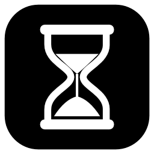
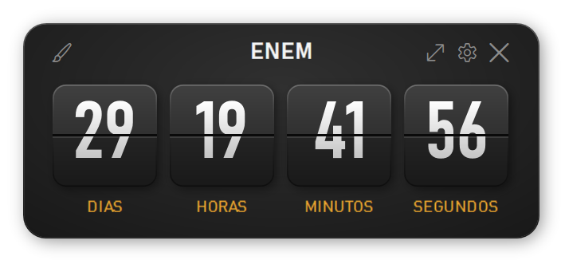
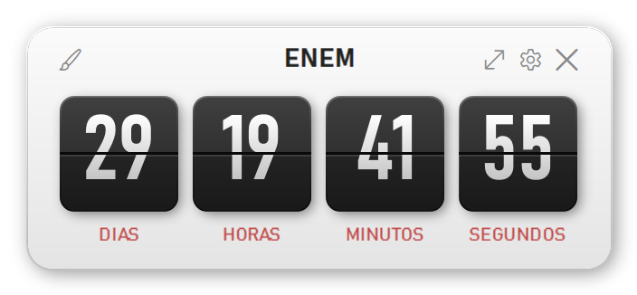
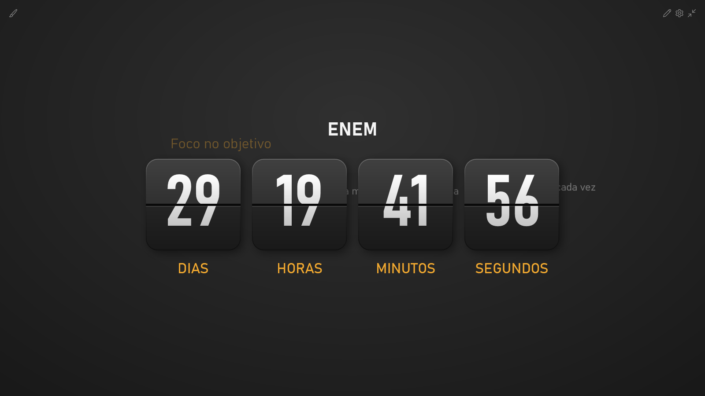
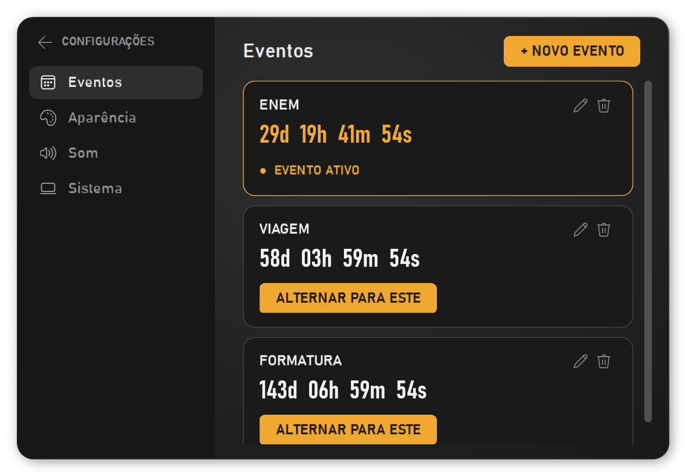
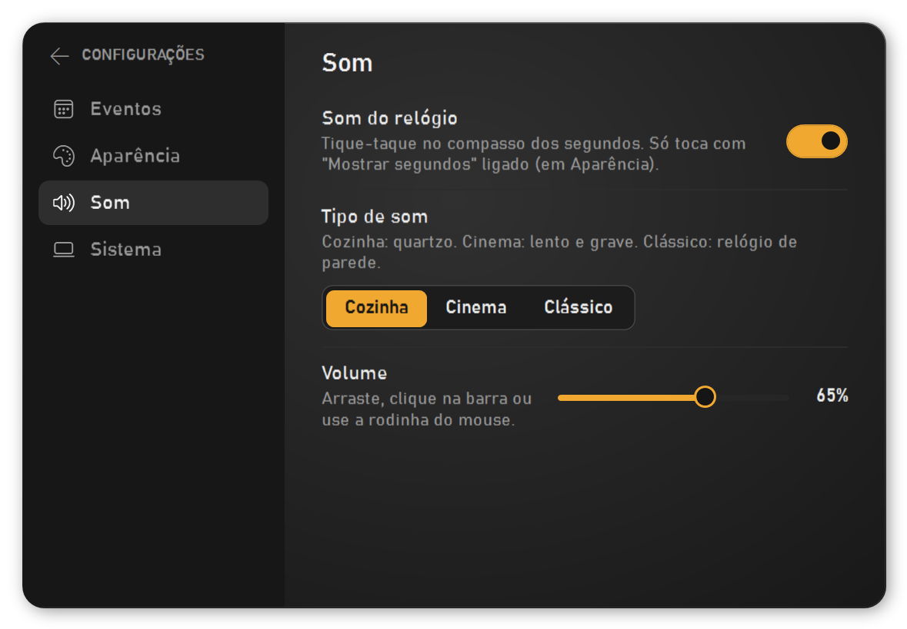

<p align="center">
  
</p>

<h1 align="center">Countdown</h1>

<p align="center">
  Contador regressivo para Windows no estilo <i>flip clock</i>: um mini pop-up flutuante que mostra quanto falta para os seus eventos importantes.
</p>

<p align="center">
  
  
  
  
  
</p>

<p align="center">
  
  
</p>

## Sobre

O Countdown fica sempre visível num cantinho da tela e conta, em dias, horas, minutos (e segundos, se quiser), quanto falta para uma data, como uma prova, uma viagem ou um aniversário. Os números viram como as plaquinhas de um relógio de aeroporto.

O cálculo é sempre **"data do evento menos agora"**, então a contagem continua certa mesmo com o app fechado ou o computador desligado.

## Funcionalidades

- **Mini pop-up flutuante**: sem barra de título, sempre por cima das outras janelas, arrastável. Lembra onde você o deixou.
- **Animação flip clock**: cada plaquinha dobra ao meio, e o número só troca quando a aba passa da metade do giro.
- **Vários eventos**: crie quantos quiser e troque o evento exibido com um clique em **"Alternar para este"**.
- **Tela cheia**: o contador é redesenhado no tamanho exato da tela, com nitidez máxima em qualquer resolução.
- **Frases motivadoras**: na tela cheia, escreva frases que ficam flutuando pela tela.
- **Tema claro e escuro**: troca no pincel do canto superior esquerdo.
- **Modo transparente**: o pop-up fica semitransparente e volta ao normal com o mouse em cima.
- **Som de relógio**: três tique-taques à escolha e controle de volume. O som acompanha o compasso das viradas dos segundos.
- **Iniciar com o Windows**: opcional, nas configurações.
- **"Chegou o dia!"**: mensagem com brilho pulsando quando a contagem termina.

<p align="center">
  
</p>

<p align="center">
  
  
</p>

## Como usar

1. Instale o **[.NET 10 Desktop Runtime](https://dotnet.microsoft.com/download/dotnet/10.0)** (se ainda não tiver).
2. Baixe o `Countdown.exe` na página de **[Releases](../../releases/latest)**.
3. Abra o `Countdown.exe`. Na primeira vez, ele pede o nome e a data do evento.

| Onde | O que faz |
|---|---|
| Pincel (canto esquerdo) | Alterna tema claro/escuro |
| Setas (canto direito) | Abre a tela cheia |
| Engrenagem | Abre as configurações (eventos, aparência, som, sistema) |
| `Esc` | Volta das configurações / sai da tela cheia |
| `Enter` | Adiciona uma frase (tela cheia) / conclui a edição de um evento |
| Rodinha do mouse | Ajusta o volume na barra de som |

Os dados ficam em `%APPDATA%\Countdown\config.json`. Tudo é salvo automaticamente, com uma cópia de segurança em `config.backup.json`.

## Como compilar

Requisito: **[.NET 10 SDK](https://dotnet.microsoft.com/download/dotnet/10.0)** no Windows.

Clone o repositório (botão **Code** acima) e, dentro da pasta, rode:

```bash
dotnet run
```

Os sons de relógio não estão no repositório (veja **Créditos**). Sem eles, o app compila e funciona normalmente, só que sem o tique-taque. Para incluí-los, baixe os sons da tabela de créditos e salve na pasta `Sounds/` com os nomes indicados.

Para gerar o executável único (`Countdown.exe` na própria pasta):

```bash
dotnet publish -c Release -r win-x64 --self-contained false -p:PublishSingleFile=true -p:DebugType=None -o .
```

## Destaques técnicos

- **Interface 100% em código C#**, sem XAML (só um estilo pequeno de barra de rolagem), tudo num único arquivo comentado: [`Countdown.cs`](Countdown.cs).
- **Nitidez máxima**: a tela cheia não amplia uma imagem; o contador é reconstruído em escala real (vetorial). O manifesto declara DPI *Per-Monitor V2*, o layout é arredondado em pixels inteiros e o `ClearTypeHint` reativa o ClearType dentro da janela transparente.
- **Animação flip em duas fases**: cada plaquinha tem quatro camadas (metades fixas + duas abas recortadas com `Clip`), animadas com `ScaleTransform`, sombreamento progressivo e um leve "quique".
- **Relógio preciso**: o timer se reagenda para o instante exato da próxima troca de número, em vez de checar em intervalos fixos.
- **Temas dinâmicos**: as cores são recursos trocados em tempo real (`SetResourceReference`), sem recriar a interface.
- **Dados à prova de perda**: gravação atômica (arquivo temporário + `File.Replace`) com backup automático, recuperação a partir do backup, migração do formato antigo e **instância única** (`Mutex` + `EventWaitHandle`) para duas cópias do app não sobrescreverem uma à outra.
- **Som sincronizado**: o `MediaPlayer` do WPF começa e recomeça junto com a virada dos segundos. Os `.mp3` vão embutidos no executável.

## Estrutura

```
Countdown/
├── Countdown.cs        # todo o código do app, comentado
├── Countdown.csproj    # projeto .NET (WPF, ícone, sons embutidos)
├── app.manifest        # nitidez em telas com escala (DPI por monitor)
├── Countdown.ico       # ícone do app
├── Sounds/             # sons de relógio (fora do repositório; embutidos no .exe da Release)
└── docs/               # ícone e capturas de tela deste README
```

## Créditos

Sons de relógio da [Pixabay](https://pixabay.com/sound-effects/), sob a [Pixabay Content License](https://pixabay.com/service/license-summary/). Essa licença não permite redistribuir os sons soltos, por isso eles **não estão no repositório**: vão só embutidos no `Countdown.exe` da página de Releases.

| Arquivo esperado em `Sounds/` | Som original | Autor |
|---|---|---|
| `relogio-cozinha.mp3` | Quartz Kitchen Clock Ticking (60 seconds) | spinopel |
| `relogio-cinematografico.mp3` | Slow Cinematic Clock Ticking | Dragon Studio |
| `relogio-classico.mp3` | Ticking Clock 1 | freesound_community |

As fontes **Bahnschrift** e **Segoe Fluent Icons** são do próprio Windows e não estão incluídas no repositório.

## Licença

Código sob a licença [MIT](LICENSE). Os sons embutidos no executável seguem a licença da Pixabay (veja **Créditos**).

---

Feito por **Vitor Gabriel**.
